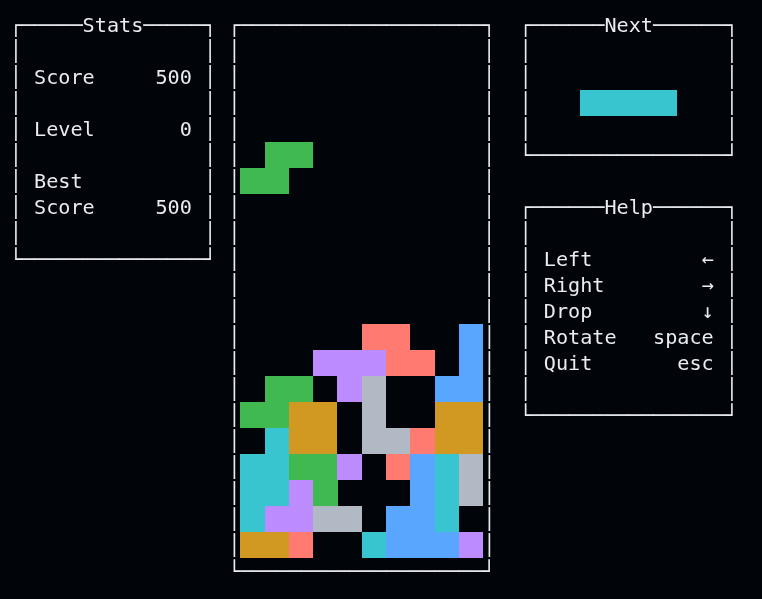

# BrickGame Tetris

A terminal Tetris game in C11 with an ncurses interface. The game logic lives in a static library, `libtetris.a`, and is implemented as a finite state machine (see the [diagram](docs/tetris_fsm_diagram.md)). The terminal interface is a separate module that only renders the game state and forwards user input.



## Features

- 10×20 field, 7 classic pieces, next-piece preview
- Line clear scoring: 1 line — 100, 2 — 300, 3 — 700, 4 — 1500
- Levels 0–10: a new level every 600 points, pieces fall faster as the level rises
- High score is saved to `highscore.dat` in the current directory
- Pause and restart after game over

## Dependencies

| Purpose | Package (Debian/Ubuntu) | Required |
|---|---|---|
| Compiler and build | `gcc`, `make` | yes |
| Interface (ncursesw) | `libncurses-dev` | yes |
| Unit tests | `check` (with `libsubunit-dev`) | for `make test` |
| Coverage report | `lcov` | for `make gcov_report` |
| Documentation | `doxygen` | for `make dvi` |
| Formatting | `clang-format` | for `make format` |
| `compile_commands.json` | `bear` | for `make linter` |

Install everything at once:

```sh
sudo apt install build-essential libncurses-dev check libsubunit-dev lcov doxygen clang-format bear
```

## Build and run

Run all commands from the repository root; build output goes to `build/`.

```sh
make            # build the game, tests and library
make run        # build and run the game
```

The build mode is set with the `MODE` variable: `release` (default, `-O2`), `debug` (`-g -O0`) or `gcov`:

```sh
make MODE=debug
```

The terminal must support UTF-8.

## Controls

| Key | Action |
|---|---|
| `Enter` | Start the game / restart after game over |
| `←` / `→` | Move the piece |
| `Space` | Rotate |
| `↓` | Hard drop |
| `p` | Pause |
| `Esc` | Quit |

## Makefile targets

| Target | Description |
|---|---|
| `all` | Build `build/tetris`, `build/tetris_test`, `build/libtetris.a` |
| `run` | Run the game |
| `test` | Run the unit tests |
| `gcov_report` | Rebuild with coverage and generate an HTML report in `build/report/` |
| `dvi` | Generate Doxygen documentation in `build/docs/html/` |
| `install` / `uninstall` | Install / remove the game in `$(PREFIX)/bin` (default `/usr/local/bin`) |
| `dist` | Package the sources into `BrickGame-v1.0.tar.gz` |
| `format` | Format the sources with `clang-format` (Google style) |
| `linter` | Generate `build/compile_commands.json` for clangd/clang-tidy |
| `clean` | Remove `build/` |

Install to a user directory without `sudo`:

```sh
make install PREFIX=$HOME/.local
```

## Project structure

```
.
├── Makefile
├── build/                       # generated by the build
├── docs/
│   ├── game_show.png            # gameplay screenshot
│   └── tetris_fsm_diagram.md    # state diagram
└── src/
    ├── brick_game/tetris/       # game logic (libtetris.a)
    │   ├── tetris.h             # public API: userInput, updateCurrentState
    │   ├── tetris_fsm.c         # finite state machine
    │   ├── tetris_field.c       # field and line clearing
    │   ├── tetris_figures.c     # pieces and rotation
    │   ├── tetris_statistics.c  # score, levels, high score
    │   └── tests/               # Check unit tests
    └── gui/cli/                 # ncurses interface
```

## License

See [LICENSE](LICENSE).
