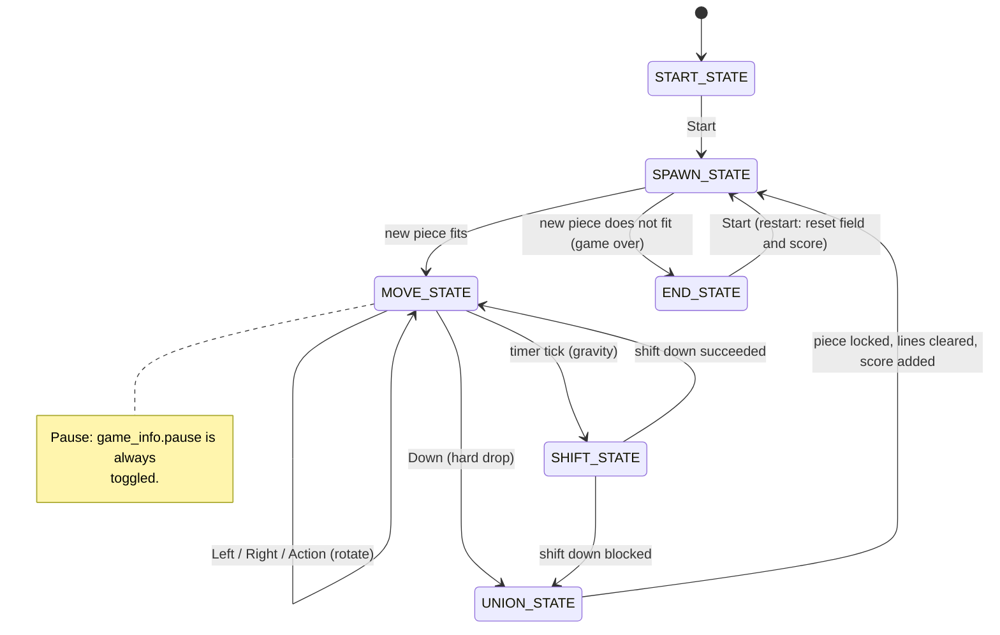

# Finite State Machine Diagram — Tetris

States and transitions match `src/brick_game/tetris/tetris_fsm.c`.

Pause is not a separate state — it is the `GameInfo_t.pause` flag, which
blocks gravity and `Left`/`Right`/`Action`/`Down` input inside
`MOVE_STATE` without changing the machine's state; it is always toggled,
regardless of its current value.

